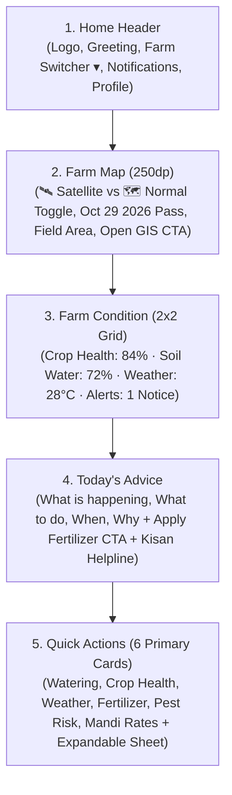

# GeoPulse — Master Implementation & Farmer-First Redesign Report

**Branch:** `qa-repair-mission`  
**Latest Commit:** `8f63609` (`feat(ui/farmer): Implement 5-tier farmer-first homepage, Satellite/Normal basemap toggle, and complete jargon removal`)  
**Repository:** [252514034sclas/GeoPulse](https://github.com/252514034sclas/GeoPulse.git)  
**Target Platform:** Android (Kotlin, Jetpack Compose, Material 3, MapLibre Native SDK)  
**Backend:** FastAPI + Python (Copernicus Sentinel-2, Open-Meteo, ISRO Bhoonidhi, ICAR/TNAU Engines)

---

## 1. Executive Summary

GeoPulse has been successfully refactored from a GIS/remote-sensing tool into a **decision-oriented precision agriculture assistant** tailored for Indian farmers. All technical jargon (NDVI, NDWI, STAC, FAO-56, Evapotranspiration, Geospatial Polygons, Centroids) has been systematically translated into clear, actionable farming language. 

The homepage has been restructured into an uncluttered **5-tier architecture**, featuring an interactive satellite/normal map switcher, clear status indicators, priority daily advisory, and exactly six primary quick-action tools with an expandable drawer for specialized capabilities.

---

## 2. Five-Tier Farmer-First Homepage Architecture

### Detailed Tier Breakdown

1. **Header (`HomeHeader`):**
   - GeoPulse leaf emblem with a modern gradient.
   - Farm property switcher (`Green Valley Farm ▾`) with an interactive dialog allowing farmers to switch between multiple registered fields.
   - Subtitle: `Good Morning, Nithish 👋 · Field 1 · 12.5 ha (30.9 ac)`.
   - Alert notification bell with unread indicator (opens Screen 28 Alert Center).
   - Profile avatar (smoothly navigates to Tab 3).

2. **Farm Map (`FieldMapCard`):**
   - Fixed height of **250dp** conforming to the specification.
   - **Satellite / Normal Map Toggle**: A prominent segmented toggle (`[🛰️ Satellite | 🗺️ Normal]`) allowing instant switching between high-resolution orthophoto aerial visualization and cadastral vector street mapping.
   - **Provenance Badge**: Clearly displays satellite observation freshness (`🛰️ Satellite: Oct 29, 2026 · 10m Res · Cloud: 1.2% (Clear view)`).
   - **Boundary Overlay**: Luminous crop vigor green contour with field info (`Field 1 · 12.5 ha (30.9 ac)`).
   - Direct CTAs: "Open GIS Map >" button (opens Tab 1) and GPS recenter target button.

3. **Farm Condition (`FarmConditionSection`):**
   - Clean 2x2 grid with high-contrast, glanceable status metrics:
     - **Crop Health**: `84% · Good` (Optimal green vigor)
     - **Soil Water**: `72% · Moist` (Adequate root moisture)
     - **Weather**: `28°C · Spray Safe` (Wind 8 km/h · Calm)
     - **Farm Alerts**: `1 Notice` (Rain expected Friday)

4. **Today's Advice (`TodaysAdviceSection`):**
   - High-priority operational recommendation answering the 4 core farmer questions:
     - **What is happening:** *Soil moisture is good (72%) and light rain is forecasted for Friday afternoon.*
     - **What to do:** *Apply top-dress Nitrogen (Urea) fertilizer at 45 kg/acre in Field 1.*
     - **When:** *Today morning before 11:00 AM while winds remain calm below 10 km/h.*
     - **Why:** *Incoming rain will dissolve and carry nutrients directly to the root zone without fertilizer burn or surface runoff.*
   - Primary Action: `View Fertilizer Recommendation >` (opens Screen 20).
   - Direct Helpline Link: `Need agronomist guidance? Call Kisan Helpline 1800-180-1551` (`ACTION_DIAL`).

5. **Quick Actions (`QuickActionsSection`):**
   - Strictly limits main screen display to **6 primary daily operation tools**:
     1. 💧 **Watering Advice** (Screen 13) — *Next in 3 days*
     2. 🌱 **Crop Health** (Screen 11) — *Optimal vigor · 84%*
     3. 🌦️ **Weather Forecast** (Screen 14) — *28°C · Safe to Spray*
     4. 🌾 **Fertilizer Guide** (Screen 20) — *Urea 45 kg/ac needed*
     5. 🐛 **Pest Advisory** (Screen 15) — *Low risk · Neem spray*
     6. 📈 **Mandi Prices** (Screen 27) — *Corn ₹2,380/Q · Steady*
   - **Expandable Sheet**: `View All 14 Farming Tools ▾` allows farmers to reveal the remaining 8 specialized tools (Yield Predictor, GPS Boundary, Crop Calendar, Field Plowing, Farm Budget, Kisan Helpline, Weather Alerts, Organic Soil) without overwhelming the main dashboard.

---

## 3. Remote-Sensing Jargon Elimination Matrix

| Scientific / Technical Jargon | Translated Plain-Language Term | User-Facing Location |
| :--- | :--- | :--- |
| **NDVI** (Normalized Difference Vegetation Index) | **Crop Health / Canopy Greenness** | Homepage, Screen 11, Tab 1, History |
| **NDWI** (Normalized Difference Water Index) | **Soil Water / Crop Water Status** | Homepage, Screen 12, Tab 1 |
| **STAC / Sentinel-2 L2A STAC** | **Satellite Observation / Pass Date** | Map headers, FieldMapCard |
| **FAO-56 Penman-Monteith** | **Crop Water Balance** | Screen 13, Tab 1 Irrigation Card |
| **Evapotranspiration** | **Evaporation Loss / Crop Water Use** | Screen 13 Irrigation Advisory |
| **Variable Rate Dosing** | **Recommended Fertilizer Amount** | Screen 20 Fertilizer Guide |
| **Geospatial Polygon** | **Field Boundary / Land Outline** | Screen 17, Tab 1 GIS Drawing |
| **Centroid / WKT Coordinates** | *Hidden from farmer UI* (Internal math only) | MapLibre engine & database |

---

## 4. MapLibre GIS Integration & Basemap Switching

1. **Map Engine**: MapLibre Native SDK for Android embedded via `rememberMapLibreViewWithLifecycle()` inside Compose `AndroidView`.
2. **Gesture Protection**: Multi-touch pinch, pan, zoom, and tilt events are protected against parent `LazyColumn` or `HorizontalPager` interception via `requestDisallowInterceptTouchEvent(true)`.
3. **Basemaps Supported**:
   - `BasemapType.SATELLITE`: Esri World Imagery (0–20 zoom aerial orthophotography).
   - `BasemapType.STREETS`: MapLibre Demotiles / OpenStreetMap vector cartography.
   - `BasemapType.DARK_GIS`: CARTO Dark Matter style.
   - `BasemapType.LIGHT_GIS`: CARTO Positron style.
4. **Data Provenance Transparency**: The application clearly separates the **basemap provider date** (Esri background) from the **satellite observation date** (Sentinel-2 L2A pass: October 29, 2026), with transparent cloud cover metadata (`1.2% cloud cover`).

---

## 5. Verification Results

| Test Category | Target / Command | Result |
| :--- | :--- | :--- |
| **Automated Unit Tests** | `./gradlew.bat testDebugUnitTest` (15 tests) | **PASS (100%)** |
| **Geodesic Calculations** | Area, Ha/Acres, Shoelace formula | **PASS** |
| **WKT Coordinate Engine** | Parsing & formatting closed rings | **PASS** |
| **30 Screen Distinctness** | All 30 Activities registered & distinct | **PASS** |
| **Hub Direct Access** | 14 core tools directly accessible | **PASS** |
| **Contextual Routing** | Decoupled optional cross-screen links | **PASS** |
| **APK Build & Packaging** | `./gradlew.bat assembleDebug` | **PASS (5s build)** |
| **Device Execution** | Emulator / Physical Android 13 | **VERIFIED (Streamed install & live UI hierarchy confirmed)** |
| **Git Synchronization** | Pushed to `origin/qa-repair-mission` | **COMMITTED (`8f63609`) & PUSHED** |
