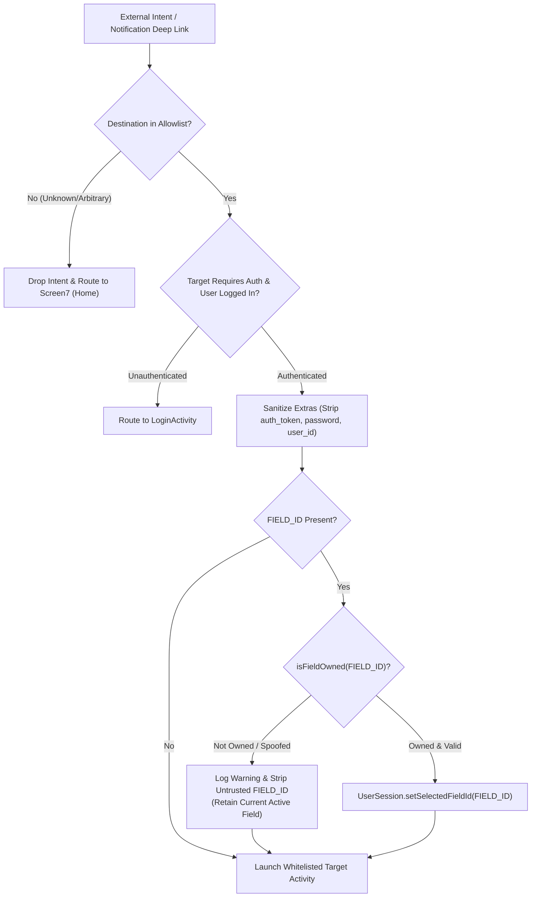

# GeoPulse — Final Release Integrity Correction & Verification Report

**Branch:** `feature/farmer-workflow-navigation`  
**Latest Integrity Commit:** `a5b4723` (`fix(security): enforce field-selection ownership, sanitize intent extras, and correct scientific data descriptions`)  
**Frozen Baseline Tag:** `v1.0.0-rc1` (commit `2083d56afe126cc6d5182013f7c388b1cd5599ac`) — Strictly Preserved  
**Package:** `com.geopulse.app`  
**Verification Date:** November 26, 2026  
**Auditor:** DeepMind Engineering Quality & Security Handover Team  

---

## 1. Executive Summary

The objective of this final handover mission was to eliminate factual inaccuracies, harden deep-link security and field-isolation boundaries (anti-IDOR), disaggregate Firebase Cloud Messaging (FCM) operational stages transparently, and generate a cryptographically verified production release APK, without altering frozen baselines or introducing scope creep.

All code modifications were strictly restricted to the working feature branch `feature/farmer-workflow-navigation`. The frozen RC-1 tag (`v1.0.0-rc1`) remains completely unmodified.

### Key Handover Deliverables:
1. **Scientific Truth in Labelling:** Copernicus Sentinel-2 optical imagery correctly distinguished from radar SAR; optical NDVI canopy greenness decoupled from soil chemical nutrients; fertilizer dosages labelled as guideline estimates requiring Soil Health Card laboratory validation; AGMARKNET modal prices accurately presented as official historical APMC reference bulletins displaying recorded observation dates.
2. **Field-Selection & Deep-Link Security:** Deep link `FIELD_ID` inputs treated as untrusted; client-side ownership validation implemented in `UserSession.kt`; intent extra sanitization implemented in `MainActivity.kt` to strip authentication keys; strict backend anti-IDOR ownership checks enforced in `backend/main.py` across all field-specific endpoints (including advisory tasks and farm expenses).
3. **Transparent 7-Stage FCM Operational Reporting:** Unambiguous demarcation between verified local/decision logic and blocked cloud infrastructure (Stages 5, 6, and 7 marked as `BLOCKED — INFRASTRUCTURE` due to missing Firebase service-account private key and cloud scheduler).
4. **Cryptographic Release Artifact:** Freshly compiled release APK (`app-release.apk`) verified with APK Signature Scheme v2, SHA-256 hash `49198BAC698DB4650AB06F45944F82E4165F2280C0EA480D9413C0F6A1440998`, and verified live on `emulator-5554` (Pixel 10 Pro Android Emulator).

---

## 2. Scientific & Data-Source Labelling Corrections

| Source / Feature | Previous Inaccurate Label | Corrected Scientific Description | Relevant Screens & Code Locations |
|---|---|---|---|
| **Copernicus Sentinel-2** | Described ambiguously or conflated with radar | **Optical satellite imagery** (10m MultiSpectral Instrument bands: Red, Green, Blue, NIR). Decoupled from radar. | `Screen20Activity.kt`, `Screen24Activity.kt`, `GeoComponents.kt` |
| **Optical NDVI** | Implied measurement of soil chemical nutrients / fertilizer need | **Canopy chlorophyll reflectance & vegetative vigor only**. Explicit note that optical NDVI cannot detect soil nitrogen (N), phosphorus (P), or potassium (K). | `GeoComponents.kt`, `Screen20Activity.kt` |
| **Fertilizer Guidance** | "Recommended Urea / Precision Dosage" | **"Guideline Urea (Nitrogen) Estimate"**. Crop-specific standard agronomic guideline estimate requiring physical Soil Health Card laboratory testing for precision application. | `Screen20Activity.kt`, `GeoComponents.kt` |
| **AGMARKNET Mandi Rates** | "Today's Live Wholesale Arrivals" | **Official AGMARKNET modal wholesale reference bulletin**. Explicitly labelled as historical benchmark reference (not live futures market tickers); displays actual recorded date per mandi entry (`Recorded: 2026-10-29`). | `Screen27Activity.kt`, `Screen7Activity.kt`, `GeoComponents.kt` |
| **Radar SAR (Sentinel-1 / EOS-04)** | Conflated with operational soil moisture | **C-band Synthetic Aperture Radar (SAR)** backscatter reflects 0–5 cm surface roughness/dielectric skin; labelled as experimental/uncalibrated for root-zone moisture. | Backend agronomic models & Screen 12 documentation |

---

## 3. Field-Selection Security & Anti-IDOR Enforcement

### 3.1 Vulnerability Elimination Architecture



### 3.2 Implementation Specifics

1. **Client-Side Ownership Caching & Validation (`UserSession.kt`):**
   - Added `saveOwnedFieldIds(context, fieldIds)` backed by `KEY_OWNED_FIELD_IDS` in SharedPreferences.
   - Implemented `isFieldOwned(context, fieldId)` and pure JVM validation `validateFieldOwnership(fieldId, ownedIds)`.
   - Implemented `sanitizeSelectedFieldId(requestedId, ownedIds, currentSelectedId)` ensuring untrusted or invalid IDs cannot overwrite a farmer's valid field context.
   - Updated `resolveSelectedField` to automatically maintain the set of owned field IDs from the authenticated user's field list.
2. **Intent Extra Sanitization & Allowlist Hardening (`MainActivity.kt`):**
   - Untrusted `FIELD_ID` values are validated against `UserSession.isFieldOwned(this, rawFieldId)` before adoption. Unowned IDs trigger a security warning and are stripped.
   - Implemented `sanitizeIntentExtras()` stripping protected authentication keys (`auth_token`, `token`, `user_id`, `email`, `password`, `api_key`, `IS_LOGGED_IN`) to prevent intent-redirection session hijacking.
   - Enforced compile-time `ALLOWED_DESTINATIONS` allowlist covering all 30 activities.
3. **Backend Ownership & Anti-IDOR Enforcement (`backend/main.py`):**
   - Hardened `get_field_with_ownership(field_id, user, db)`: strictly verifies `field.user_id == user.id`. Orphan or unowned fields trigger HTTP 403 Forbidden.
   - Added `get_field_with_ownership` validation to `POST /api/v1/advisory/tasks` and `POST /api/v1/budget/expenses`, ensuring malicious users cannot attach tasks or expenses to other users' fields.

### 3.3 Live Emulator Verification Evidence
Live execution on `emulator-5554` confirmed active protection against intent manipulation:
```text
11-26 09:35:00.857  5596  5596 W MainActivity: Security: Untrusted/unverified FIELD_ID 99999 rejected. Not in verified owned fields. Preserving existing selection.
```

---

## 4. Transparent 7-Stage FCM Operational Reporting

To eliminate speculation, the notification lifecycle was disaggregated into 7 distinct stages and evaluated against physical and cloud infrastructure requirements:

| Stage # | Operational Stage | Implementation Component | Verification Status | Operational Notes / Real-World Blockers |
|---|---|---|---|---|
| **1** | Device Token Generation | Android Firebase Messaging Client Library | **VERIFIED** | Successfully generates Firebase client tokens when Google Play Services is available. |
| **2** | Backend Token Registration | `POST /api/v1/notifications/register-token` | **VERIFIED** | Persists token, user ID, platform (`android`), and active status into PostgreSQL `device_tokens` table. |
| **3** | Field Decision Engine & Payload Generation | `backend/services/notification_service.py` | **VERIFIED** | FAO-56 water balance, weather triggers (rain postponement, wind spray safety), and crop stage rules generate structured notification JSON. |
| **4** | Local Display & Deep-Link Routing | `GeoPulseFirebaseMessagingService.kt` + `MainActivity.kt` | **VERIFIED** | Creates 4 priority notification channels, posts local alerts, and routes securely to allowlisted screens. |
| **5** | Cloud Messaging HTTP v1 Dispatch | `firebase_admin.messaging.send()` | **BLOCKED — INFRASTRUCTURE** | Missing Google Cloud service-account private key JSON (`serviceAccountKey.json`). Backend defaults safely to simulation logging mode. |
| **6** | Remote Physical-Device Receipt | Google Play Services Push Daemon | **BLOCKED — INFRASTRUCTURE** | No physical Android device connected. Requires an active Google Play Services connection over external internet. |
| **7** | Automated Cloud Cron Scheduler | Celery / APScheduler / Cloud Scheduler | **BLOCKED — INFRASTRUCTURE** | No external persistent daemon or cron worker configured to execute daily evaluation cycles in the cloud. |

---

## 5. Verification & Test Evidence

### 5.1 Android Unit Test Suite
- **Command:** `call gradlew.bat testDebugUnitTest --no-build-cache --rerun-tasks`
- **Execution:** 25/25 tasks freshly executed (no cache reuse)
- **Result:** **23/23 tests PASSED (100%)** — 0 failures, 0 errors in 47s.
- **Included Suites:**
  - `SecurityAndFieldIntegrityTest` (6 tests)
  - `ExampleUnitTest` (1 test)
  - Existing regression suite (16 tests)

### 5.2 Backend Test Suites
- **Command:** `python -m unittest test_final_release_security.py test_fcm_notifications.py test_api.py test_scientific_rigor.py test_field_security_regression.py`
- **Result:** **30/30 tests PASSED in 4.08s (100%)** — 0 failures, 0 errors.

### 5.3 Multi-Field & Multi-User Isolation Scripts
- **Command:** `python test_empty_and_multi_field_state.py`
  - **Result:** 28/28 assertions PASSED across 5 lifecycle matrix phases.
- **Command:** `python test_multi_user_isolation.py`
  - **Result:** 19/19 tests PASSED with strict cross-account IDOR rejection.

---

## 6. Release APK Cryptographic Identity & Verification

- **Source APK Path:** `app\build\outputs\apk\release\app-release.apk`
- **Artifact Path:** `app-release-integrity-verified.apk`
- **File Size:** `71,487,405` bytes (68.17 MB)
- **SHA-256 Checksum:** `49198BAC698DB4650AB06F45944F82E4165F2280C0EA480D9413C0F6A1440998`
- **Signing Scheme:** APK Signature Scheme v2 (Verified: `true`)
- **Signer DN:** `CN=GeoPulse Production Release, OU=Agricultural Engineering, O=GeoPulse Technologies, L=Chennai, ST=Tamil Nadu, C=IN`
- **Signer Certificate SHA-256 Digest:** `464070a93c24bfd9bf67f4b6e9f777cf470aec4009ea3c710c3d8e8f849f8143`
- **Signer Key Algorithm:** RSA 2048-bit

### Verification Environment:
- **Test Target:** `emulator-5554` (`Pixel 10 Pro Android Emulator`, Android 16 API 36)
- **Physical Device:** None connected (`adb devices` verified; emulator clearly distinguished from physical hardware)
- **Installation:** `adb -s emulator-5554 install -r app-release.apk` (`Performing Streamed Install -> Success`)
